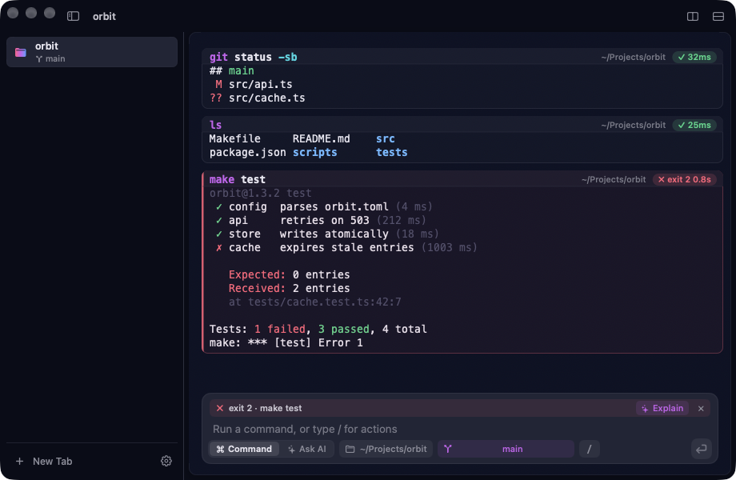

# Cue

A native macOS terminal with a real input bar, where every command comes back as a card with its output, exit code and duration.



**Website:** [cue.coursion.studio](https://cue.coursion.studio/)

> This repository holds Cue's website, its Sparkle update feed (`appcast.xml`) and the release downloads. The app's source code is not in this repository.

## Install

**Homebrew**

```sh
brew install --cask coursion-studio/tools/cue
```

**Download**

Get the latest DMG from [Releases](https://github.com/Coursion-Studio/cue/releases/latest), open it and drag Cue to Applications. Builds are signed with a Developer ID and notarized by Apple.

## Requirements

- **macOS:** 15 Sequoia or later, on Apple silicon.
- **Font:** a [Nerd Font](https://www.nerdfonts.com/) is recommended, so prompt glyphs render.
- **AI (optional):** an Anthropic API key, or the `claude` CLI on your `PATH`.

## Features

- **Composer and command cards:** type in a native input bar with autocomplete, history and `/` commands. Each command becomes a card with its output, exit code and duration; copy it, run it again, or explain a failure. When a program asks for input, the composer turns into a question field.
- **Command palette:** ⌘K searches menu commands, slash commands, tabs, themes (previewed live), snippets and recent folders; type `>` to search history.
- **Quick Terminal:** ⌃` slides a terminal down over any app and keeps its session between visits.
- **Projects:** Cue detects Node, Swift, Rust, Go, Python, Make, just and Docker Compose projects, lists their tasks and shows git state, and warns when your node or python version differs from the project's.
- **Fold:** collapse a card to one line; cards over 200 lines open trimmed.
- **Find:** search the whole pane, one card or failed cards only, with match case and regex.
- **Session restore:** Cue reopens your windows, tabs, splits and folders, optionally with each pane's last lines.
- **Share as Image:** turn any card into a PNG in your theme, with secrets redacted by default.
- **AI with your own Claude:** explain an error, fix the last command, or describe what you want and get a command back, using your Anthropic API key (kept in the Keychain) or the `claude` CLI. Secrets are redacted before anything is sent.
- **Themes, tabs and splits:** eighteen themes, tabs in a sidebar or along the top, and split panes.
- **Shells:** zsh, bash and fish, without editing your dotfiles.

## Keyboard shortcuts

| Shortcut | Action |
|---|---|
| ⌘K | Command palette |
| ⇧⌘K | Clear |
| ⇧⌘P | Snippets |
| ⌃R | Search history |
| ⌃` | Quick Terminal (global, configurable) |
| ⌘B | Show or hide the tab sidebar |
| ⌘F | Find in output |

## Updates

Cue updates itself through [Sparkle](https://sparkle-project.org/): it checks once a day, and you can choose **Check for Updates…** in the Cue menu. Release notes are on the [website](https://cue.coursion.studio/releases.html), and every download is on the [Releases](https://github.com/Coursion-Studio/cue/releases) page.

## Privacy

Cue has no analytics, telemetry or account. See the [privacy page](https://cue.coursion.studio/privacy.html) for the two cases where it uses the network.

---

© 2026 [Coursion Studio](https://coursion.studio)
